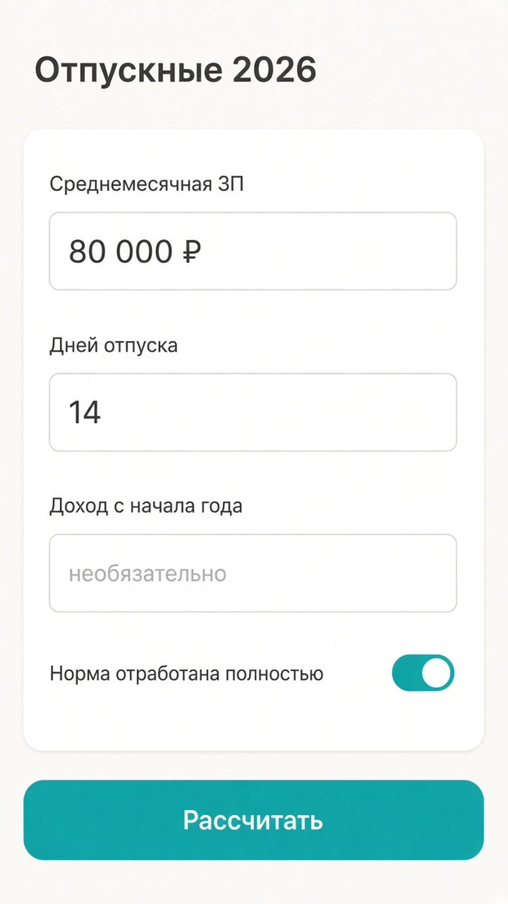
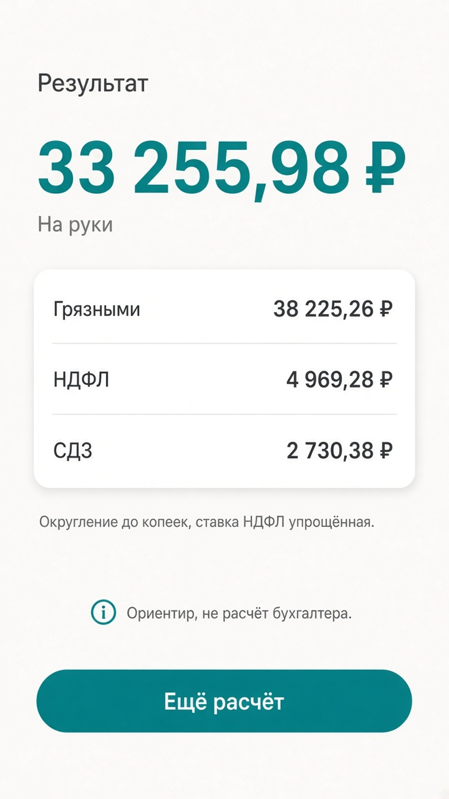
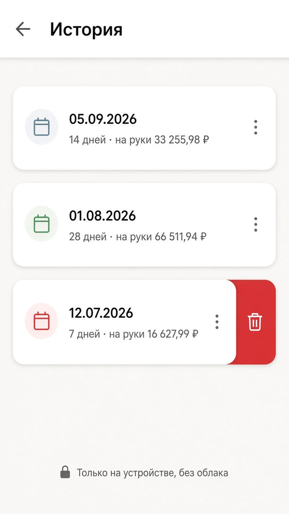
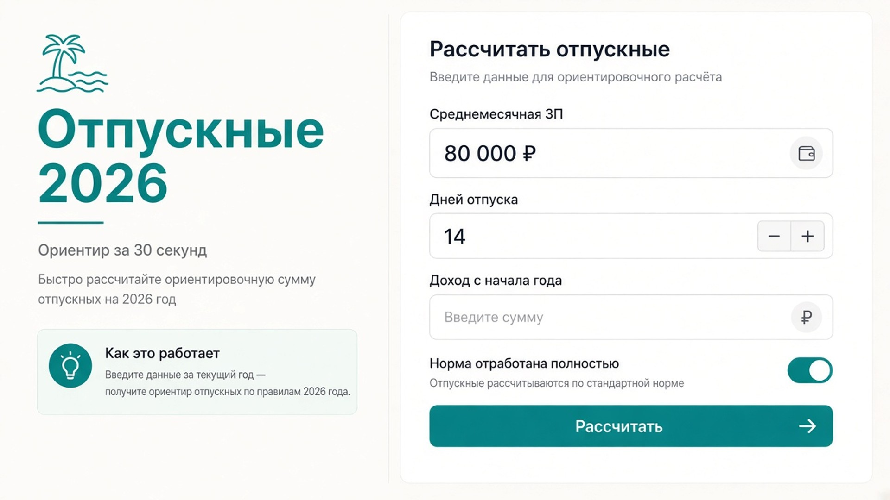
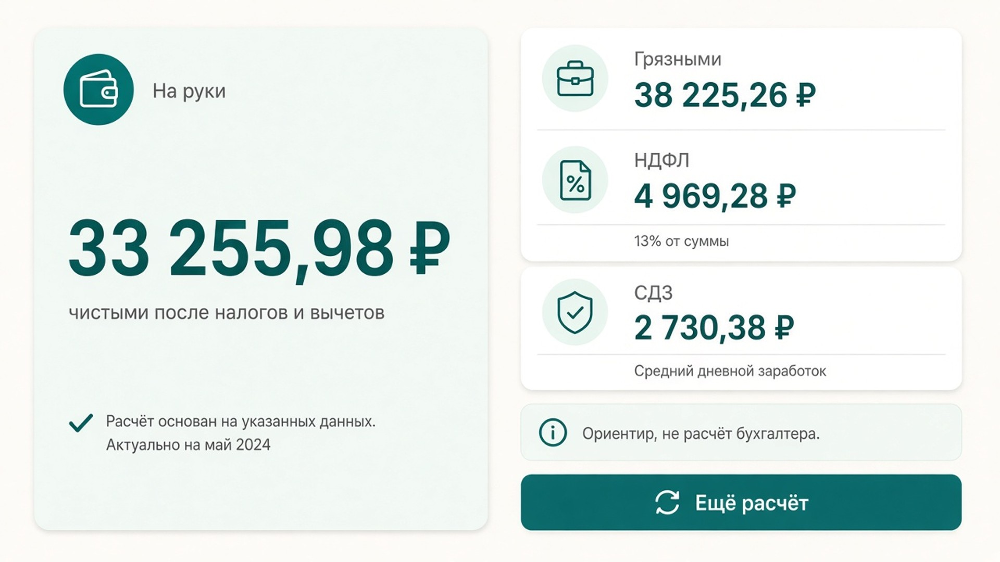
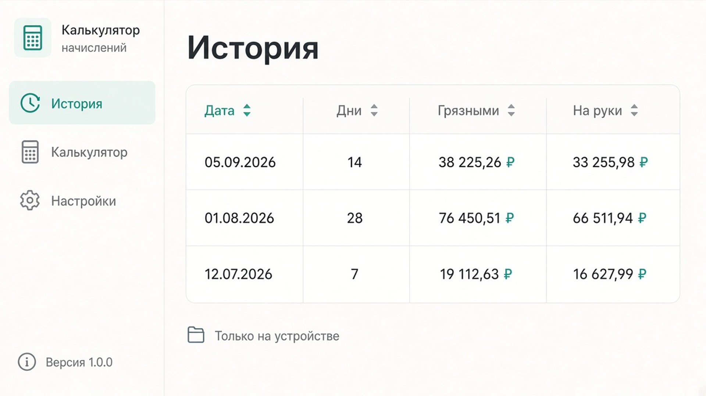

# Отпускные 2026

Ориентировочный расчёт отпускных за ~30 секунд: грязными, НДФЛ и на руки.

Без аккаунта, без облака. Android-приложение для RuStore.

  

## Скриншоты

### Телефон

| Форма | Результат | История |
| :---: | :---: | :---: |
|  |  |  |

### Планшет

| Форма | Результат | История |
| :---: | :---: | :---: |
|  |  |  |

## Возможности

- сумма грязными и на руки;
- НДФЛ 13% / 15% с учётом дохода с начала года;
- средний дневной заработок (СДЗ);
- пол МРОТ при полной норме;
- праздники в периоде отпуска (ст. 112 ТК РФ);
- районный коэффициент;
- история последних расчётов на устройстве.

## Важно

Это ориентир, не расчёт бухгалтера и не юридическая консультация.

Исходный код: [github.com/VasiliySafrygin/vacancy2026](https://github.com/VasiliySafrygin/vacancy2026)

[Политика конфиденциальности](https://github.com/VasiliySafrygin/vacancy2026/blob/main/rustore/privacy_policy.md)
